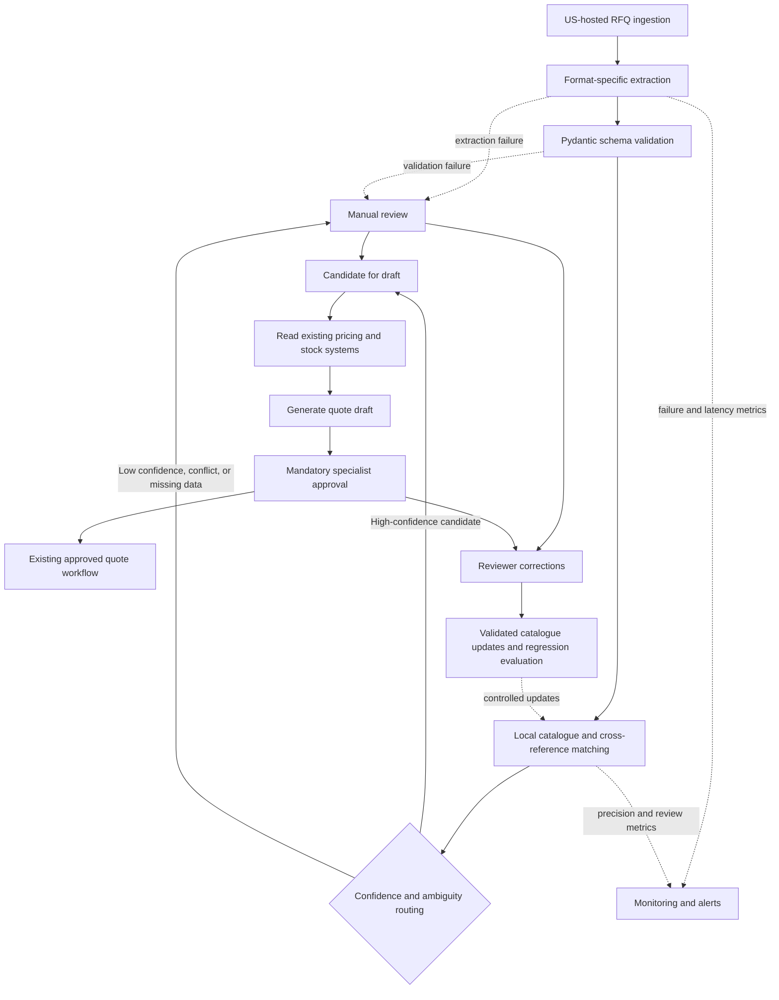

# Ridgeline Quote Desk

## Repository
https://github.com/Eyong2015/ridgeline-rfq-pipeline
Ridgeline Quote Desk is a local, deterministic RFQ extraction and product-matching prototype. It reads the six examples in `rfqs/`, uses `customers.csv`, `products.csv`, and `cross_reference.csv`, and writes sanitized draft data to `outputs/`. It does not generate prices, submit quotes, or call a runtime model provider.

## How to Run

Use Python 3.9 from the repository root:

```bash
python3.9 -m venv .venv
source .venv/bin/activate
python -m pip install --upgrade pip
python -m pip install -r requirements.txt

python smoke_test.py
python pipeline.py
python evaluate.py
```

`smoke_test.py` reports extraction results for supported RFQ files. `pipeline.py` processes each supported file and writes `outputs/<filename_stem>.json`. `evaluate.py` compares extracted and matched lines with available references and writes `evaluation/results.json`. Evaluation requires the local `answer_key/` data; only `evaluate.py` reads it.

## Approach

- **Format-specific extraction:** TXT parsing handles email bodies and forwarded revisions; PyMuPDF extracts PDF text and table rows; openpyxl reads XLSX rows using detected headers. Images are emitted as one OCR-required review stub rather than guessed from.
- **Validation and uncertainty:** Pydantic enforces positive line numbers and quantities when present, confidence in `[0, 1]`, non-empty RFQ IDs, and supported match methods. Unknown quantities, units, customers, and ambiguous references remain null or flagged rather than inferred.
- **Matching order:** Look up supplier identifiers in `cross_reference.csv` first, then search for exact Ridgeline part numbers, then use RapidFuzz description similarity. Competing candidates, specification or unit conflicts, and references to unavailable prior orders cause abstention. Product references used internally are omitted from output JSON.
- **Confidence and review:** The initial description-match review threshold is 0.8. Extraction uncertainty flags are retained, and low-confidence or otherwise uncertain lines require review. Every generated quote draft still requires human specialist approval.
- **Execution model:** Extraction and matching run locally and deterministically with installed libraries and CSV data. There is no runtime model provider or external API call.

## Evaluation

`evaluate.py` evaluates the RFQs with line-level answer-key records at thresholds 0.7, 0.8, and 0.9. Its metrics are defined as follows:

- **Extraction accuracy:** Correct compared extraction fields divided by all compared fields. Line numbers must match; normalized source text must reach a token-set similarity of 0.85; quantities must agree within `1e-6`; and units are compared after normalization. Missing lines add their expected fields to the denominator, while extra lines add the average expected fields and no correct fields.
- **Matching precision and recall:** A true positive is a predicted Ridgeline part number equal to the expected part on the same line. A wrong predicted part counts as both a false positive and a false negative; missed expected matches are false negatives, and unsupported predictions are false positives. Precision is `TP / (TP + FP)` and recall is `TP / (TP + FN)`.
- **Review rate:** Lines marked `needs_review` divided by predicted lines in the scored RFQs.
- **Accepted-match precision:** Correct matches not marked for review divided by all matches not marked for review.

The saved results in `evaluation/results.json` at threshold 0.8 are: extraction accuracy **0.9474**, matching precision **1.0000**, recall **0.5882**, **10 TP / 0 FP / 7 FN**, review rate **0.5789**, and accepted-match precision **1.0000**. The tested thresholds 0.7, 0.8, and 0.9 produced identical metrics because none changed the accepted candidate decisions in this evaluation.

The 0.8 threshold is provisional, not calibrated: answer-key coverage is only **3 of 6 RFQs**, with a small set of labeled lines. The high observed precision and limited recall should not be treated as production guarantees. Build a larger, privacy-reviewed labeled set from historically approved quotes and reviewer decisions; measure coverage, precision, and recall on held-out examples before changing the threshold.

## Production

The following is a proposed deployment flow, not an implemented quote-submission integration:



- **Failure handling:** Route extraction failures, unsupported formats, and validation errors to manual review. Add a parser and regression cases before enabling any new format.
- **Monitoring and proposed alerts:** Alert on extraction failures above **2% over 15 minutes** (minimum 20 documents); review rate above **70% over seven days** (minimum 50 lines); p95 processing latency above **2 seconds per RFQ for 15 minutes**; or matching precision below **98% across the latest 50 adjudicated matches**. Treat low-volume metrics as informational until their minimum sample is met.
- **Runtime and cost:** The measured batch runtime was **0.632 seconds for six RFQs**. Runtime LLM API cost is **$0**. Illustratively, at **$0.05 per vCPU-hour**, assuming one vCPU billed only while processing, compute is about **$0.0000015 per RFQ**. This excludes idle server time, storage, networking, monitoring, and human review.
- **Feedback loop:** Record reviewer corrections with provenance. Promote catalogue or cross-reference changes only after validation, then run them through regression evaluation before release.
- **Two-week roadmap:** **Week 1:** evaluate OCR for images, improve recall using reviewed corrections, and calibrate confidence against labeled examples. **Week 2:** broaden format/customer regression coverage and test enterprise identity, US-region deployment, access control, monitoring, and read-only pricing/stock integration.
